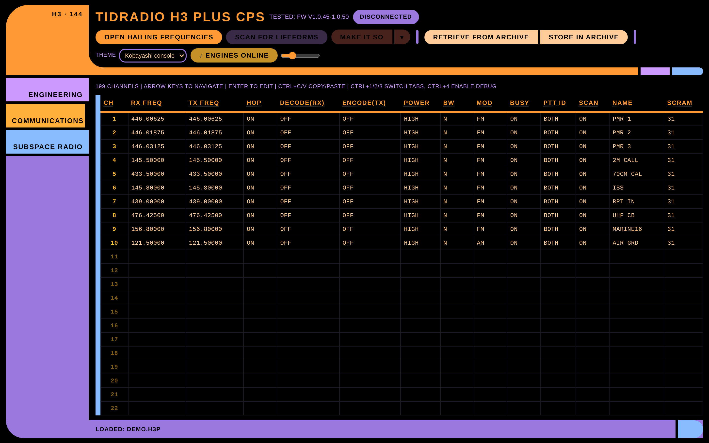

# Tidradio H3 Plus Web CPS

Web-based CPS for Tidradio H3 Plus radio using Web Bluetooth written in pure HTML+CSS+JS, runs in your browser.

**[Launch App](https://jamarju.github.io/tid-h3-plus-cps/)**

## Quick Start

1. Enable Bluetooth on your H3 Plus (Menu > Settings > Bluetooth > ON)
2. Open the app in Chrome or Edge
3. Click **Connect** and select your radio
4. Click **Read** to download configuration
5. Edit channels/settings
6. Click **Write** to upload changes

## Screenshots

### Channels

### Settings

### Debug

### Kobayashi console theme

Choose **Theme → Kobayashi console** in the header for a retro sci-fi control panel with elbow frames, pill buttons and a side rail. It is an original take on the look, made in CSS only, with no logos, fonts or sounds from any TV show. The main buttons get playful names (Read is *Scan for lifeforms*, Write is *Make it so*, and so on); hover any of them for the plain name.

It also plays an engine-room hum made live in your browser with the Web Audio API (no recordings). The hum is on by default at 25% and starts on your first click, because browsers don't allow sound before that. Press **♪ Engines online** to mute it, or use the slider; the app remembers both. The theme is the default every 8 September unless you've picked a theme. The default look is unchanged.

## File Format

Configurations are saved as `.h3p` files - raw 16KB binary dumps of radio memory. This preserves all data including unknown fields for future compatibility.

## Development

See [info/](info/) for memory maps and protocol documentation.

The actual app is in [`docs/`](docs/) due to limitation of GitHub Pages.

Issues and pull requests are welcome!

## License

MIT
